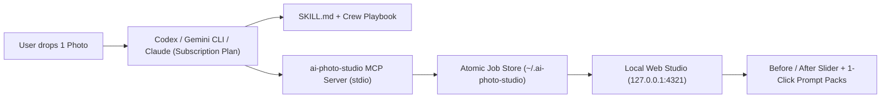

# ai-photo-studio

[](https://github.com/deusbr/ai-photo-studio/actions/workflows/ci.yml)
[](LICENSE)
[](package.json)
[](package.json)

Zero-dependency **Full-Crew AI Photo Editing Studio** for **Codex**, **Gemini CLI**, and **Claude Code / Claude Desktop** — combining a portable multi-agent **Skill (`SKILL.md`)**, a **`stdio` MCP Server**, and a **Local Web Studio UI** designed to run on your existing plan subscription without requiring extra image API keys.

Drop a single photo and let a **7-member professional studio crew** direct the entire transformation from forensic deconstruction to final QA.

---

## The 7-Member Studio Crew

| # | Role | Responsibility |
| :--- | :--- | :--- |
| 1 | **Executive Producer / Showrunner** | Intakes the anchor photo (`PNG`/`JPEG`/`WebP`), inspects dimensions/ratio, selects preset, and coordinates the pipeline. |
| 2 | **Photo Deconstruction & Forensics Analyst** | Audits 5 axes (pose, lens distortion, lighting, sensor/optics, crop) and enforces the **Visual Anti-Inertia Rule**. |
| 3 | **Creative & Art Director** | Defines concept, wardrobe or product styling, location/backdrop, and cohesive color palette. |
| 4 | **Director of Photography (DoP) & Lighting** | Specifies camera/emulsion (Hasselblad X2D, Leica M11, Portra 400, CineStill 800T), prime lens, angle, Kelvin temp, and iris catchlights. |
| 5 | **Pose, Expression & Set Stylist** | Directs anatomical posture, jawline projection, relaxed gaze, hand/prop anchors, or commercial staging. |
| 6 | **Master Prompt & Edit Compiler** | Compiles engine-tailored production packs for **Codex (ChatGPT Image)**, **Gemini**, and **Claude / Universal JSON**. |
| 7 | **Colorist, Retoucher & QA Director** | Audits `After` vs `Before` across 6 fidelity/texture checks and issues `pass` or `revise` notes for `v2`. |

---

## Architecture



---

## Quick Start

### 1. Install MCP + Skill across Codex, Gemini CLI, and Claude
```bash
node bin/ai-photo-studio.cjs install
node bin/ai-photo-studio.cjs status
```

Target paths configured automatically (with atomic writes and symlink checks):
- **Codex:** `~/.codex/config.toml` + `~/.agents/skills/ai-photo-studio/`
- **Gemini CLI:** `~/.gemini/settings.json` + `~/.gemini/skills/ai-photo-studio/`
- **Claude Code:** `~/.claude.json` + `~/.claude/skills/ai-photo-studio/`
- **Claude Desktop:** `%APPDATA%/Claude/claude_desktop_config.json` (Windows) / `~/Library/Application Support/Claude/claude_desktop_config.json` (macOS)

### 2. Launch the Local Web Studio
```bash
node bin/ai-photo-studio.cjs web --port 4321
```
Open `http://127.0.0.1:4321` to upload photos, inspect each crew specialist's deliverable, copy tailored prompts in one click, and compare **Before / After** renders with an interactive slider.

### 3. MCP Tools Exposed (`bin/mcp-server.cjs`)
- `studio_list_crew`
- `studio_create_job`
- `studio_save_crew_pass`
- `studio_compile_prompts`
- `studio_register_render`
- `studio_submit_qa`
- `studio_get_job` / `studio_list_jobs`
- `studio_start_web`

---

## Development & Tests

```bash
npm run check
npm test
```

## License

MIT — see [`LICENSE`](LICENSE).