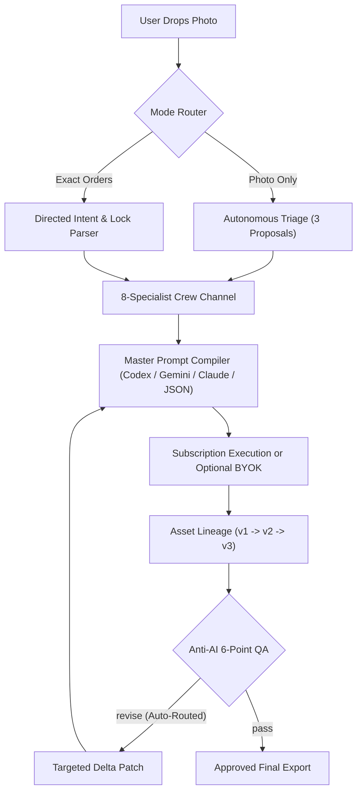

# ai-photo-studio

[](https://github.com/deusbr/ai-photo-studio/actions/workflows/ci.yml)
[](LICENSE)
[](package.json)
[](package.json)

Zero-dependency **8-Agent Autonomous & Directed AI Photo Studio** for **OpenBot**, **Codex**, **Gemini CLI**, and **Claude Code / Claude Desktop** — combining a portable multi-agent **Skill (`SKILL.md`)**, a **`stdio` MCP Server**, a **CLI**, and a **Local Web Studio Workbench**.

Built to run **Subscription-First** (zero API keys required) on your existing AI plan, with optional BYOK execution (`GEMINI_API_KEY` / `OPENAI_API_KEY` / `COMFYUI_URL`) when configured.

---

## Operating Modes

1. **Autonomous Mode (`auto` / `studio_run_autonomous`):**
   Drop **only a photo** with zero instructions. Tall mobile screenshots are auto-cropped (`anchor_clean`) to strip UI bars; the Showrunner & Forensic Analyst triage the image (`portrait`, `couple`, `product`, `executive`, `night`, `outdoor`), generate **3 curated creative proposals**, run the full 8-specialist crew pipeline, log the **Studio Channel Board**, and compile production prompts immediately.
2. **Directed Mode (`direct` / `studio_run_directed`):**
   Give **exact art direction orders**. A bilingual (`EN` / `PT-BR`) intent classifier detects your **Intervention Scope** (`subtle-retouch`, `targeted-edit`, `full-editorial`) and locks immutable attributes (`keepPose`, `keepWardrobe`, `keepBackground`, `keepFraming`) so specialists execute your vision with zero unauthorized drift.
3. **Multi-Shot Photo Essay Mode (`essay` / `studio_run_essay`):**
   Plan and compile a cohesive **2–6 shot editorial storyboard** (default 5 shots: `35mm` walk-by, `50mm` cafe, `35mm` architectural courtyard, `85mm` intimate close-up, `50mm` golden-hour rim) varying lenses, poses, and camera angles while locking identity and garment micro-details across every frame.

Optional `--analyze` / `studio_analyze_photo` runs standalone BYOK vision extraction (`GEMINI_API_KEY` or `OPENAI_API_KEY`) when running outside an AI host.

---

## The 8-Specialist Studio Crew

| # | Agent Handle | Role ID | Responsibility |
| :--- | :--- | :--- | :--- |
| 1 | **Diretor de Ensaio** | `showrunner-director` | Mode routing (`autonomous` / `directed`), scope classification, and production mandate. |
| 2 | **Analista Forense** | `forensic-analyst` | 5-axis technical photo audit + **Visual Anti-Inertia** rules. |
| 3 | **Guardião de Consistência** | `consistency-guardian` | Biometric/product anchoring, `expressionTruth`, `garmentMicroDetails` (logos/patches/stripes), `antiBeautificationLocks`, and **Zero-Invention Policy**. |
| 4 | **Diretor de Arte & Styling** | `art-stylist` | Concept, wardrobe/props, set/backdrop, posture geometry, and palette bounded by locks. |
| 5 | **Especialista em Iluminação** | `lighting-director` | 3D volumetry, key/fill/rim architecture, Kelvin temperature, and iris/specular catchlights. |
| 6 | **Câmera & Lentes** | `camera-optics` | Camera body, film/sensor emulsion, prime lens, angle, and color science. |
| 7 | **Editor Master** | `prompt-editor` | Compiles `codexPrompt`, `geminiPrompt`, `claudeComfyPrompt`, `universalJsonSpec`, and `revisionDeltaPrompt`. |
| 8 | **Auditor Anti-IA & Realismo** | `anti-ai-auditor` | 8-axis Anti-Slop & Garment QA gatekeeper (`pass` / `revise`) with targeted **Correction Routing** and Asset Lineage (`v1 -> v2 -> v3`). |

---

## Architecture



---

## Quick Start

### 1. Install MCP + Skill across Codex, Gemini CLI, and Claude
```bash
node bin/ai-photo-studio.cjs install
node bin/ai-photo-studio.cjs status
```

### 2. Run Autonomous or Directed Mode from the CLI
```bash
# Autonomous: drop a photo and let the 8-agent crew decide + propose 3 concepts
node bin/ai-photo-studio.cjs auto ./photo.jpg

# Directed (Subtle Retouch): keep pose, outfit, and background — polish lighting only
node bin/ai-photo-studio.cjs direct ./photo.jpg --brief "Mantenha minha pose, roupa e fundo; melhore apenas a iluminação" --scope subtle-retouch

# Multi-Shot Essay: plan 5 varied shots (35mm, 50mm, 85mm) from one photo
node bin/ai-photo-studio.cjs essay ./photo.jpg --count 5

# Directed (Full Editorial): explicit art direction
node bin/ai-photo-studio.cjs direct ./photo.jpg --brief "Editorial GQ night cafe portrait, 50mm f/1.2, CineStill 800T"
```

### 3. Launch the Local Web Studio Workbench
```bash
node bin/ai-photo-studio.cjs web --port 4321
```
Open `http://127.0.0.1:4321` to switch between **Autonomous** and **Directed Orders**, toggle 3 autonomous proposals, inspect the **Studio Channel Handoff Log**, compare **Anchor / v1 / v2** with the interactive slider, copy prompts, and submit **6-Point Anti-AI QA** scorecards.

### 4. MCP Tools Exposed (`bin/mcp-server.cjs`)
- `studio_list_crew` — list 8 specialists, 7 presets, operating modes, and available executors
- `studio_create_job` — intake anchor photo (with optional `autoRun`)
- `studio_run_autonomous` — run full autonomous triage + 3 proposals + 8-agent orchestration
- `studio_run_directed` — run directed orchestration enforcing brief, scope, and locks
- `studio_run_essay` — plan and compile a 2–6 shot multi-angle photo essay storyboard
- `studio_analyze_photo` — optional BYOK vision extraction (`GEMINI_API_KEY` / `OPENAI_API_KEY`)
- `studio_select_proposal` — switch between autonomous proposals and recompile
- `studio_save_crew_pass` — update/override any specialist pass (supports v1 role aliases)
- `studio_compile_prompts` — recompile engine prompt packs
- `studio_execute_render` — optional BYOK execution (`GEMINI_API_KEY` / `OPENAI_API_KEY`)
- `studio_register_render` — attach render version (`v1`, `v2`, ...) to lineage
- `studio_submit_qa` — 6-point Anti-AI QA scorecard with automatic correction routing & delta patch
- `studio_get_job` / `studio_list_jobs` / `studio_start_web`

---

## Development & Tests

```bash
npm run check
npm test
```

## License

MIT — see [`LICENSE`](LICENSE).
